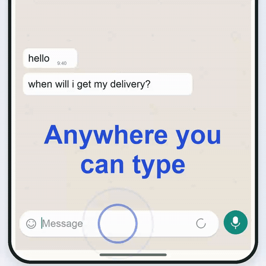

# Quill

Voice dictation for Android, with your own API key. Tap the floating bubble, speak, and Quill inserts your words into a supported text field without switching keyboards.

**[Download Android preview 1.0.23](https://github.com/someanay/quill/releases/tag/android-v1.0.23)** · [Quick start](#get-quill) · [Privacy](docs/privacy-policy.md) · [Help](docs/support.md)

*The bundled onboarding demonstration uses sample text. Click it to watch the original video.*

## Get Quill

The current Android preview is **1.0.23**, version code **24**, package **com.quill.quill**. Android 10 or later is required.

1. Download the signed APK from the [preview release](https://github.com/someanay/quill/releases/tag/android-v1.0.23). Its SHA-256 checksum is included.
2. Install it on your Android phone and open Quill.
3. Add your own Groq key using the onboarding instructions. Other supported provider configurations are available in Settings.
4. Grant microphone, display-over-other-apps and accessibility access when prompted.
5. Open a supported text field, tap the Quill bubble and speak.

Quill is free to use. Your chosen API provider may charge for usage. Review the [app terms](docs/terms.md) and [privacy policy](docs/privacy-policy.md) before installing.

This is a preview release. The latest automated Android suite has 431 passing tests; the remaining physical-phone and Play submission checks are tracked in [release readiness](docs/play-readiness.md). This repository does not claim a production Play Store release or a completed device compatibility matrix.

## What it does

- Dictates from a floating bubble into supported Android text fields.
- Encrypts provider keys with Android Keystore.
- Offers optional AI cleanup, custom words, contacts vocabulary and local history.
- Applies writing-style defaults for [540 app packages](docs/app-styles.md), with per-app overrides.
- Provides clipboard fallback when direct insertion is unavailable.
- Explains permission, recording and provider failures with specific recovery actions.
- Supports private mode and configurable history retention.

Audio goes directly to the speech provider you select. Optional cleanup sends text to the cleanup provider you select. Quill has no dictation backend, app account, advertising or analytics SDK. Provider data handling is governed by that provider's terms.

Android and individual apps control which text fields can be accessed. Quill checks for password fields; compatibility and OEM background restrictions vary. See the [device test plan](testing_plan.md).

## Help and feedback

Use [bug reports](https://github.com/someanay/quill/issues/new?template=bug_report.yml) for reproducible problems and [support guidance](docs/support.md) for setup help. For privacy or security matters, email [quillapp@agentmail.to](mailto:quillapp@agentmail.to).

Never put API keys, private recordings, transcripts or personal contact details in public issues. See [security reporting](SECURITY.md).

## Source viewing terms

Quill's original source is proprietary and available for viewing only. Building, running, modifying or redistributing the source requires separate written permission. GitHub's platform rights and third-party licenses are preserved.

Official compiled Quill applications are covered separately by the [app terms](docs/terms.md). Read the [source viewing terms](LICENSE) and [third-party notices](docs/open-source-licenses.md).

## Development for authorized contributors

The instructions below apply to copyright holders and contributors with written permission under the [source viewing terms](LICENSE).

Use a full JDK 21, Android SDK platform **37.0**, build tools **37.0.0**, and the checked-in Gradle wrapper. Keep local SDK and signing configuration outside version control.

~~~sh
./gradlew testDebugUnitTest lintDebug assembleRelease bundleRelease
~~~

On Windows, use gradlew.bat. Unsigned builds work without release credentials. Signed releases require the local signing configuration described in [CONTRIBUTING.md](CONTRIBUTING.md).

~~~powershell
./scripts/build-android-release.ps1 -VersionCode 24 -VersionName 1.0.23
~~~

Use a higher version code for a new Play upload. The release script checks tests, lint, signatures and alignment, and writes distributable APK/AAB files plus checksums to the ignored dist/android directory. Binaries belong in GitHub Releases, not the source tree.

All interface copy is bundled in the app. After an authorized copy edit, regenerate copy-manifest.json with the generateCopyManifest task and rebuild the app. There is no remote copy update service.

## Project documentation

- [Current Android release readiness](docs/play-readiness.md)
- [Key setup](docs/key-setup.md)
- [Dictation errors and recovery](docs/dictation-errors.md)
- [Product requirements](prd.md)
- [Architecture](spec.md)
- [Milestones](todo.md)
- [Testing](testing_plan.md)
- [Contributing](CONTRIBUTING.md)

Planning documents retain historical decisions. The current Android preview and release-readiness record take precedence over older version numbers, retired remote-copy plans and platform experiments retained in Git history.
